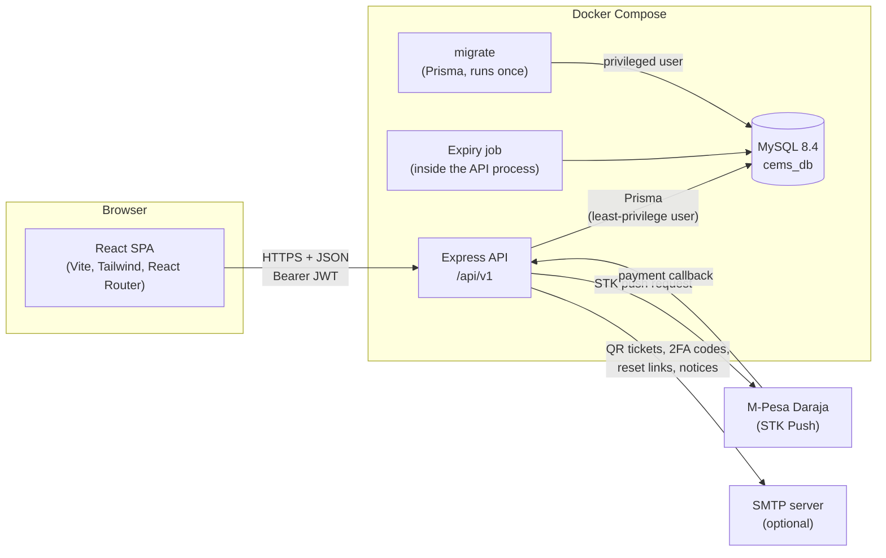
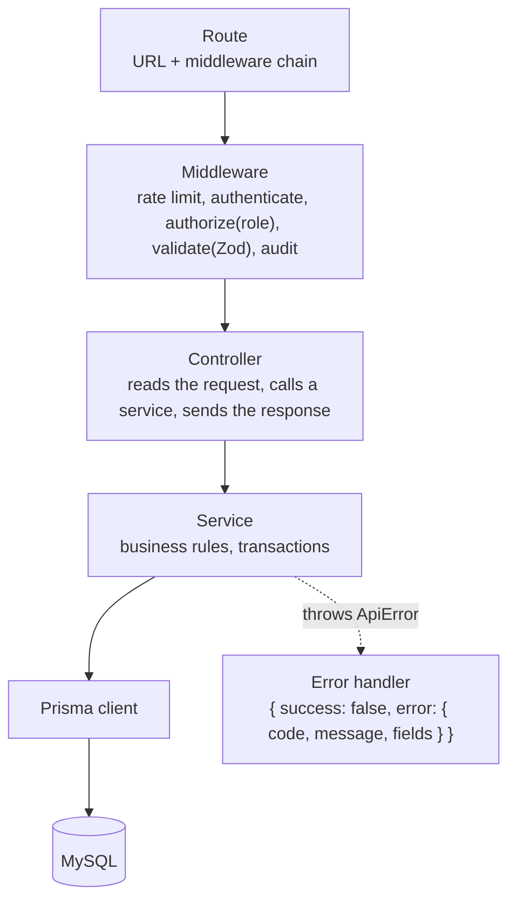
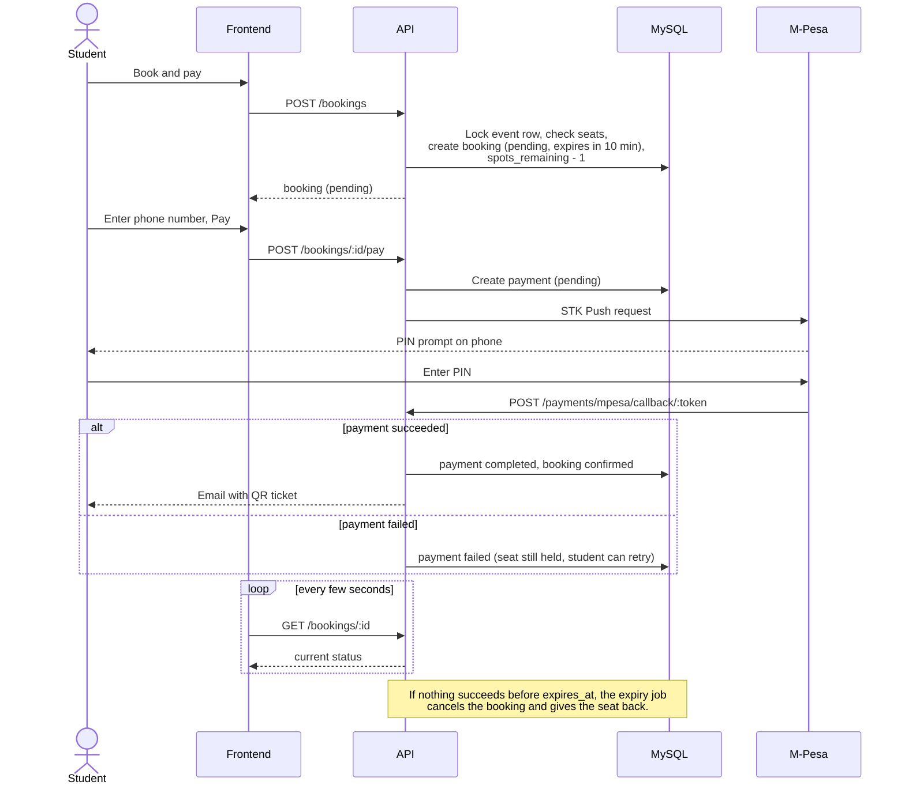
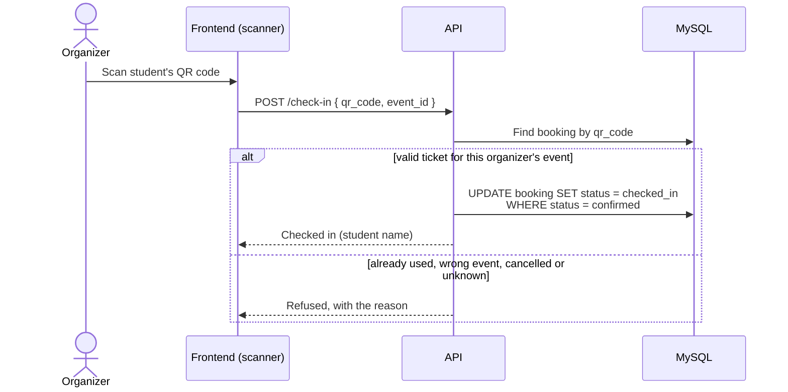
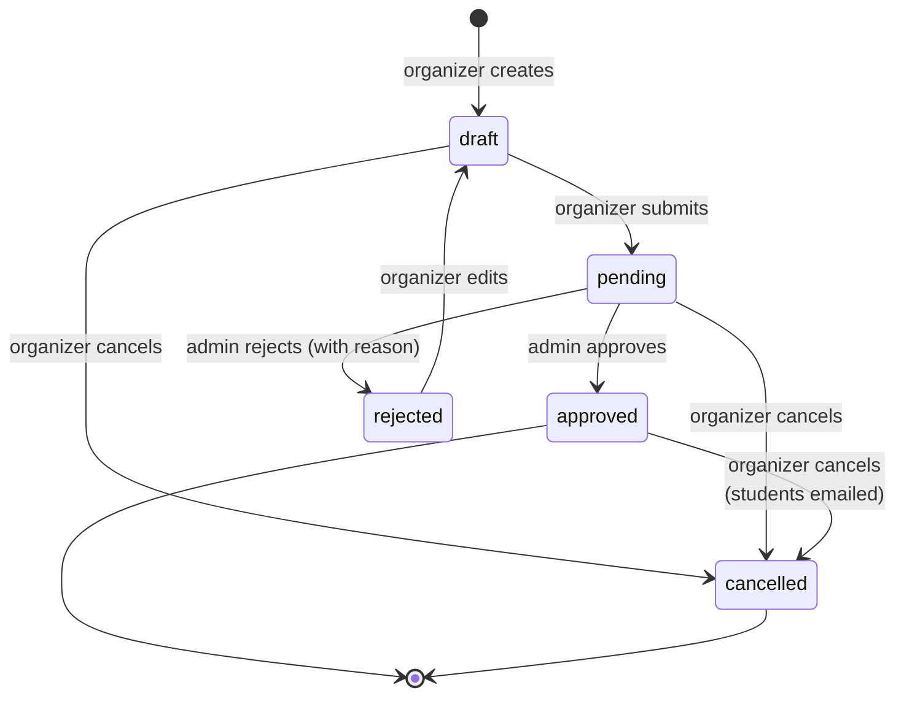
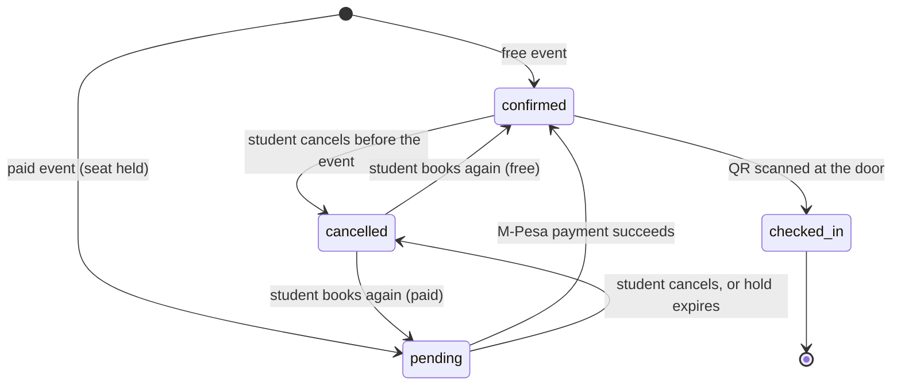

# Architecture

## System overview

CEMS is a single-page React app talking to a REST API, which stores everything in MySQL.
Two outside services are involved: Safaricom's M-Pesa Daraja API for payments, and an SMTP
server for email.

| Part        | Technology                                                    | Where                  |
| ----------- | ------------------------------------------------------------- | ---------------------- |
| Frontend    | React 18, Vite, Tailwind CSS, React Router, Axios, Recharts, html5-qrcode | `frontend/`  |
| API         | Node.js, Express, Zod validation, JWT, bcrypt, Helmet, Nodemailer, PDFKit | `backend/`   |
| Database    | MySQL 8.4 through Prisma ORM                                  | `backend/prisma/`      |
| Deployment  | Docker Compose: `db`, `migrate`, `backend`                    | `docker-compose.yml`   |
| CI          | GitHub Actions: lint, format, tests, frontend build           | `.github/workflows/`   |

## Backend layers

Every request goes through the same layers. Each layer has one job, so business rules live in
one place (the services) and can be tested without HTTP.

| Folder              | Contains                                                              |
| ------------------- | --------------------------------------------------------------------- |
| `src/routes/`       | One router per resource, mounted in `routes/index.js`                 |
| `src/middleware/`   | `authenticate`, `authorize`, `validate`, rate limiters, audit, errors |
| `src/controllers/`  | Thin HTTP handlers                                                    |
| `src/services/`     | Business logic: auth, events, bookings, payments, check-in, reports   |
| `src/validators/`   | Zod schemas for every request body and query                          |
| `src/jobs/`         | The pending-booking expiry job                                        |
| `src/docs/`         | OpenAPI spec served by Swagger UI at `/api/docs`                      |

Every response has the same shape: `{ success: true, data, meta? }` on success, and
`{ success: false, error: { code, message, fields? } }` on failure, so the frontend handles
errors in one place.

## Main API resources

| Resource              | Who                     | Purpose                                              |
| --------------------- | ----------------------- | ---------------------------------------------------- |
| `/auth`               | everyone                | Register, login, 2FA, logout, password reset          |
| `/events`             | public, organizers      | Browse approved events; organizers create and manage their own |
| `/categories`, `/venues` | public, admins       | Reference data; admins manage it                     |
| `/bookings`           | students                | Book, pay, view tickets, cancel                       |
| `/payments/mpesa/callback/:token` | Safaricom   | Payment results                                      |
| `/check-in`           | organizers              | Validate a QR ticket and mark it used                 |
| `/admin/events`       | admins                  | Approval queue                                       |
| `/admin/users`        | admins                  | User management                                      |
| `/reports`            | admins                  | Attendance, category and organizer reports (JSON and PDF) |
| `/audit-logs`         | admins                  | Audit trail (JSON and PDF)                           |

The full list, with request and response formats, is in Swagger at `/api/docs`.

## Booking and payment

Free events are confirmed at once. Paid events hold the seat while the student pays with
M-Pesa.

How the design keeps this correct:

- **No overbooking.** Booking locks the event row (`SELECT ... FOR UPDATE`) inside a
  transaction before checking and decrementing `spots_remaining`. A CHECK constraint also
  stops it going below 0.
- **Callbacks are idempotent.** A repeated callback finds the payment is no longer `pending`
  and changes nothing.
- **The callback URL is secret.** It contains `MPESA_CALLBACK_TOKEN`, so only Safaricom (who
  was given the URL) can post results.
- **Abandoned payments don't block seats.** The expiry job releases seats held past
  `expires_at`. Before expiring a booking it asks Safaricom for the result, in case a
  callback was lost.
- **Late money isn't lost.** A payment that arrives after expiry re-takes a seat if one is
  free, or is flagged for refund.

## QR check-in

The QR code holds a random, unguessable token (not a booking ID). The check-in is one
conditional `UPDATE`, so even two scanners reading the same ticket at the same moment cannot
both succeed.

## Status lifecycles

### Event

Only `approved` events are visible to students and open for booking.

### Booking

A student has at most one booking row per event; booking again re-uses the cancelled row.

## Security

| Concern                 | How it is handled                                                                   |
| ----------------------- | ----------------------------------------------------------------------------------- |
| Passwords               | bcrypt hashes; never returned by the API                                            |
| Sessions                | Short-lived JWTs, renewed while active; logged out after 30 minutes idle            |
| Logout and revocation   | Each user has a `token_version`; logout, password change, deactivation and role change bump it, so old tokens stop working at once |
| Admin login             | Email one-time code (2FA) after the password; configurable per role                  |
| Access control          | `authorize(role)` on every protected route; organizers only see and scan their own events; only super admins manage admins |
| Brute force             | Rate limits on login, 2FA, password reset and registration                          |
| Input                   | Every body and query validated with Zod; request size limited to 100 KB             |
| HTTP headers and CORS   | Helmet; CORS only allows the frontend's origin (`CLIENT_URL`)                       |
| Password reset          | Single-use link; only a SHA-256 hash of the token is stored; expires in 30 minutes  |
| Database                | The API connects as a least-privilege user (read/write rows only); migrations use a separate privileged account |
| Accountability          | Audit log of logins, bookings, payments, check-ins, approvals and user changes      |
| Secrets                 | `.env` files are gitignored; `.env.example` files document every setting            |

## Testing

- **Backend:** Jest and Supertest, 18 suites and 188 tests, run against a real MySQL test
  database (`cems_test`) so transactions, locks and constraints are tested for real. The test
  setup refuses any database whose name doesn't end in `_test`.
- **Frontend:** ESLint and a production build.
- **CI:** both run on every push and pull request (`.github/workflows/ci.yml`).
