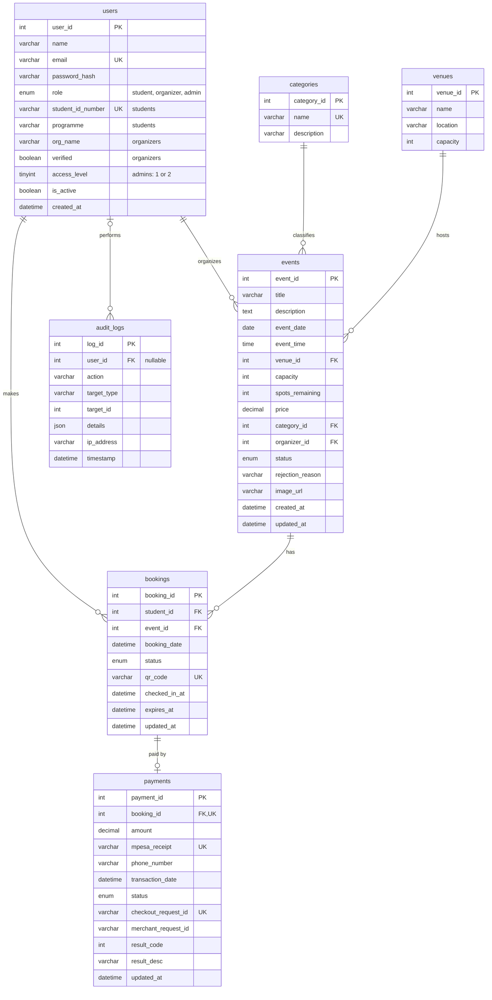

# Database schema

MySQL 8.4 database `cems_db`, InnoDB, `utf8mb4`. Seven tables in third normal form. The
source of truth is [backend/prisma/schema.prisma](../backend/prisma/schema.prisma); the SQL
that creates the tables is in
[backend/prisma/migrations/](../backend/prisma/migrations/).

Columns marked **added** were not in the original Deliverable 2 design. They were added during
development for password reset, 2FA, session revocation, M-Pesa callbacks and payment expiry.

## Entity-relationship diagram

The diagram leaves out the security columns on `users` (password reset, 2FA,
`token_version`); they are listed below.

## Tables

### users

Students, organizers and admins in one table. Columns that don't apply to a user's role are
NULL.

| Column                       | Type          | Notes                                                       |
| ---------------------------- | ------------- | ----------------------------------------------------------- |
| `user_id`                    | INT PK        | Auto-increment                                              |
| `name`                       | VARCHAR(100)  |                                                             |
| `email`                      | VARCHAR(150)  | Unique; used to log in                                       |
| `password_hash`              | VARCHAR(255)  | bcrypt                                                      |
| `role`                       | ENUM          | `student`, `organizer`, `admin`                             |
| `student_id_number`          | VARCHAR(20)   | Students only; unique                                       |
| `programme`                  | VARCHAR(100)  | Students only; optional                                     |
| `org_name`                   | VARCHAR(150)  | Organizers only                                             |
| `verified`                   | BOOLEAN       | Organizers only; set by an admin                            |
| `access_level`               | TINYINT       | Admins only: 1 = admin, 2 = super admin; CHECK NULL, 1 or 2 |
| `is_active`                  | BOOLEAN       | FALSE = deactivated, cannot log in                          |
| `created_at`                 | DATETIME      |                                                             |
| `password_reset_token_hash`  | CHAR(64)      | **Added.** SHA-256 of the emailed reset token; unique        |
| `password_reset_expires_at`  | DATETIME      | **Added.**                                                   |
| `twofa_code_hash`            | VARCHAR(255)  | **Added.** Hash of the emailed 6-digit code                  |
| `twofa_expires_at`           | DATETIME      | **Added.**                                                   |
| `twofa_attempts`             | TINYINT       | **Added.** Failed code attempts                              |
| `token_version`              | INT           | **Added.** Bumped to invalidate all of a user's sessions     |

### categories

| Column        | Type          | Notes                     |
| ------------- | ------------- | ------------------------- |
| `category_id` | INT PK        |                           |
| `name`        | VARCHAR(50)   | Unique                    |
| `description` | VARCHAR(255)  | Optional                  |

### venues

| Column     | Type          | Notes                        |
| ---------- | ------------- | ---------------------------- |
| `venue_id` | INT PK        |                              |
| `name`     | VARCHAR(100)  |                              |
| `location` | VARCHAR(255)  |                              |
| `capacity` | INT           | CHECK `capacity > 0`         |

### events

| Column             | Type           | Notes                                                        |
| ------------------ | -------------- | ------------------------------------------------------------ |
| `event_id`         | INT PK         |                                                              |
| `title`            | VARCHAR(150)   |                                                              |
| `description`      | TEXT           |                                                              |
| `event_date`       | DATE           |                                                              |
| `event_time`       | TIME           |                                                              |
| `venue_id`         | INT FK         | → `venues`; cannot delete a venue that has events            |
| `capacity`         | INT            | CHECK `capacity > 0`                                         |
| `spots_remaining`  | INT            | CHECK `0 <= spots_remaining <= capacity`; decremented under a row lock |
| `price`            | DECIMAL(10,2)  | 0 = free; CHECK `price >= 0`                                 |
| `category_id`      | INT FK         | → `categories`; cannot delete a category that has events     |
| `organizer_id`     | INT FK         | → `users`                                                    |
| `status`           | ENUM           | `draft` (**added**), `pending`, `approved`, `rejected`, `cancelled` |
| `rejection_reason` | VARCHAR(500)   | **Added.** Shown to the organizer                             |
| `image_url`        | VARCHAR(500)   | Optional                                                     |
| `created_at`, `updated_at` | DATETIME |                                                           |

### bookings

The core transaction: one row per student per event.

| Column          | Type          | Notes                                                           |
| --------------- | ------------- | --------------------------------------------------------------- |
| `booking_id`    | INT PK        |                                                                 |
| `student_id`    | INT FK        | → `users`                                                       |
| `event_id`      | INT FK        | → `events`                                                      |
| `booking_date`  | DATETIME      |                                                                 |
| `status`        | ENUM          | `pending` (awaiting payment), `confirmed`, `cancelled`, `checked_in` |
| `qr_code`       | VARCHAR(255)  | Unique random token encoded in the QR ticket                    |
| `checked_in_at` | DATETIME      | Set at check-in                                                 |
| `expires_at`    | DATETIME      | **Added.** End of the seat hold for an unpaid booking            |
| `updated_at`    | DATETIME      |                                                                 |

UNIQUE (`student_id`, `event_id`): a student who cancels and books again re-uses the same row.

### payments

One M-Pesa payment per paid booking.

| Column                 | Type          | Notes                                                  |
| ---------------------- | ------------- | ------------------------------------------------------ |
| `payment_id`           | INT PK        |                                                        |
| `booking_id`           | INT FK        | → `bookings`; unique (1:1)                             |
| `amount`               | DECIMAL(10,2) | CHECK `amount > 0`                                      |
| `mpesa_receipt`        | VARCHAR(50)   | Unique; set when the payment succeeds                   |
| `phone_number`         | VARCHAR(15)   | Format `2547XXXXXXXX`                                   |
| `transaction_date`     | DATETIME      |                                                        |
| `status`               | ENUM          | `pending`, `completed`, `failed`                        |
| `checkout_request_id`  | VARCHAR(100)  | **Added.** Unique; matches the Daraja callback to the payment |
| `merchant_request_id`  | VARCHAR(100)  | **Added.**                                              |
| `result_code`          | INT           | **Added.** Daraja ResultCode (0 = success)              |
| `result_desc`          | VARCHAR(255)  | **Added.** Daraja ResultDesc                            |
| `updated_at`           | DATETIME      |                                                        |

### audit_logs

| Column        | Type          | Notes                                                        |
| ------------- | ------------- | ------------------------------------------------------------ |
| `log_id`      | INT PK        |                                                              |
| `user_id`     | INT FK        | → `users`; NULL for system actions and failed logins; set to NULL if the user is removed |
| `action`      | VARCHAR(255)  | e.g. `APPROVE_EVENT`, `PAYMENT_COMPLETED`, `CHECK_IN`        |
| `target_type` | VARCHAR(50)   | e.g. `event`, `booking`, `user`                              |
| `target_id`   | INT           | **Added nullable**: some actions (login) have no target       |
| `details`     | JSON          | **Added.** Extra context, e.g. a rejection reason             |
| `ip_address`  | VARCHAR(45)   | **Added.** IPv4 or IPv6                                       |
| `timestamp`   | DATETIME      |                                                              |

## Integrity rules

- **Foreign keys** use `RESTRICT`, so a user, venue, category, event or booking that other rows
  depend on cannot be deleted and history is never orphaned. The one exception is
  `audit_logs.user_id`, which uses `SET NULL` to keep the audit trail.
- **CHECK constraints** (written by hand in the first migration, since Prisma cannot express
  them): `venues.capacity > 0`, `events.capacity > 0`,
  `0 <= events.spots_remaining <= events.capacity`, `events.price >= 0`,
  `payments.amount > 0`, and `users.access_level` is NULL, 1 or 2.

## Indexes

Besides primary keys and unique columns:

| Table        | Index                         | Speeds up                                       |
| ------------ | ----------------------------- | ----------------------------------------------- |
| `users`      | `role`                        | Filtering users by role                         |
| `events`     | `status, event_date`          | The public list of upcoming approved events     |
| `events`     | `category_id`, `organizer_id`, `venue_id` | Filters and joins                   |
| `bookings`   | `event_id, status`            | Counting seats and attendance per event          |
| `bookings`   | `student_id`                  | "My bookings"                                   |
| `bookings`   | `status, expires_at`          | The expiry job finding held seats that ran out  |
| `payments`   | `status`                      | Reports and the expiry job                      |
| `audit_logs` | `user_id, timestamp`, `action`, `timestamp` | Audit log filters                |

## Database accounts

| Account                 | Privileges                                | Used by                       |
| ----------------------- | ----------------------------------------- | ----------------------------- |
| `cems_app`              | SELECT, INSERT, UPDATE, DELETE on `cems_db` | The running API (`DATABASE_URL`) |
| `root` (or another admin) | Full                                    | Migrations and seeding (`MIGRATION_DATABASE_URL`) |

So even if the API were compromised, it could not drop or alter tables.
